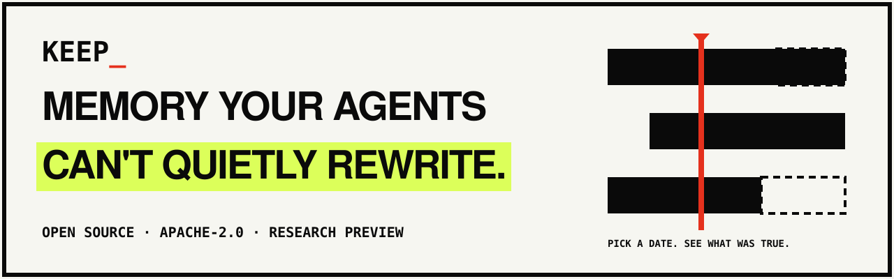

<p align="center">
  <a href="https://keep.tulipfarm.ai"></a>
</p>

<p align="center">
  <a href="https://github.com/TulipFarm/keep/releases"></a>
  <a href="https://github.com/TulipFarm/keep/actions/workflows/ci.yml"></a>
  <a href="https://github.com/TulipFarm/keep/actions/workflows/image.yml"></a>
  <a href="https://github.com/TulipFarm/keep/pkgs/container/keep"></a>
  <a href="LICENSE"></a>
  
  
  
  <a href="https://github.com/TulipFarm/keep/stargazers"></a>
</p>

<p align="center">
  <a href="https://keep.tulipfarm.ai"><b>Website</b></a> ·
  <a href="docs/server.md">Docs</a> ·
  <a href="https://github.com/TulipFarm/keep">GitHub</a> ·
  <a href="https://github.com/TulipFarm/keep/issues">Issues</a> ·
  <a href="https://tulipfarm.ai">TulipFarm</a>
</p>

# Keep

Keep is an open-source memory and knowledge system for AI agents, written in
Rust. It is built around two primitives:

- **Memory files** — small, curated Markdown files an agent reads at the start
  of every session (preferences, standing instructions, project conventions).
  Every change is a revision, so memory can be reviewed, diffed and rolled back.
- **Knowledge** — an append-only record of what happened (episodes) and the
  facts derived from it, searchable on demand. Facts keep their provenance and
  validity over time instead of being silently overwritten.

## Quick start

Paste this into Claude Code, Codex or Copilot CLI:

```text
Read https://keep.tulipfarm.ai/install.md and install Keep for me.
```

The agent follows [install.md](https://keep.tulipfarm.ai/install.md): it asks
where to store memory (Postgres + pgvector, Postgres + Qdrant, or in memory),
builds Keep, starts it on 127.0.0.1:7357 and connects Claude Code, Codex and
Copilot CLI if they are installed. Restart your agents afterwards.

Or run the installer yourself:

```sh
curl -fsSL https://keep.tulipfarm.ai/install.sh | sh
```

It asks the same questions. It runs on macOS and Linux, and the Postgres
options need Docker. For a container, use `ghcr.io/tulipfarm/keep:<version>`
from the [latest release](https://github.com/TulipFarm/keep/releases/latest). See
[Connecting coding agents](#connecting-coding-agents) for the manual steps. On
a small or shared host, [CPU use](docs/server.md#cpu-use) lists the settings
that cap how many cores embedding and background jobs take.

## Status: research first

Keep is at the very start. Before building the engine, we are building the
benchmark harness that will decide whether it is worth building: a
preregistered, reproducible way to compare Keep against simple baselines
(full context, BM25, dense retrieval, plain notes) on public long-term memory
benchmarks. If Keep does not beat those baselines, we will say so.

What exists today:

| Crate | Purpose |
| --- | --- |
| `keep-core` | Domain types for Memory files, revisions, episodes and facts; content hashing |
| `keep-providers` | Chat, embedding and tokenizer traits; deterministic mock providers; an OpenAI-compatible client that refuses to dispatch unless explicitly allowed; budget caps |
| `keep-store` | Lexical (BM25) and vector index contracts with in-memory implementations |
| `keep-postgres` | pgvector adapter |
| `keep-qdrant` | Qdrant adapter |
| `keep-memory` | The Memory primitive: lossless Markdown entries, revisions, compare-and-swap edits, trash, undo, forget, context assembly, export and import |
| `keep-ledger` | Postgres storage for Memory, with its own migrations |
| `keep-knowledge` | The Knowledge primitive: bi-temporal facts with evidence, hybrid search, a permission-safe book index and forgetting. See [docs/knowledge.md](docs/knowledge.md) |
| `keep-bench` | The benchmark harness library and `keep-bench` CLI |
| `keep-server` | The `keep` binary: Memory and Knowledge for coding agents over MCP (stdio) and HTTP. See [docs/server.md](docs/server.md) |

Every Keep ablation arm runs in the harness: Memory only (`keep-m*`),
Knowledge only (K0, K1) and both together (Mk0, Mk1). See
[docs/memory.md](docs/memory.md) for how Memory works.

## Running the harness

Requires Rust (the pinned toolchain in `rust-toolchain.toml` installs
automatically through rustup) and, optionally, Docker.

```sh
cargo test --workspace                       # unit and integration tests, offline
cargo run -p keep-bench -- dry-run fixtures/manifests/longmemeval-mock.toml
cargo run -p keep-bench -- run fixtures/manifests/longmemeval-mock.toml
cargo run -p keep-bench -- run fixtures/manifests/longmemeval-memory-mock.toml
cargo run -p keep-bench -- run fixtures/manifests/ablation-mock.toml
cargo run -p keep-bench -- report results/<run-id>
```

Everything above runs offline with mock models and synthetic fixtures. Mock
output measures the plumbing, not memory quality: never quote it as a result.

Real benchmark data is downloaded separately and never committed:

```sh
scripts/fetch-datasets.sh                    # LoCoMo, LongMemEval-S, oracle → data/
cargo run --release -p keep-bench -- dry-run manifests/longmemeval-s-dev.toml
```

The manifests in `manifests/` are templates: model pins are placeholders and
budget caps are zero, so they cannot call a model until someone fills them in
deliberately. Remote model calls need `dispatch.allow_model_calls = true` in
the manifest **and** `--allow-model-calls` on the command line.

For development without API keys, `manifests/dev/` runs answer and judge
calls through a locally installed, signed-in GitHub Copilot CLI and embeds
with a pinned local ONNX model:

```sh
cargo run --release -p keep-bench --features local-embeddings -- \
  dry-run manifests/dev/locomo-copilot-dev.toml
cargo run --release -p keep-bench --features local-embeddings -- \
  run manifests/dev/locomo-copilot-dev.toml --allow-model-calls
```

These runs are **non-canonical**: the CLI adds its own hidden system prompt
and does not pin the upstream model. Every artifact is stamped as such, the
run stops at the manifest's AI-credit cap, and `keep-bench compare` refuses
them unless `--allow-non-canonical` asks for an internal comparison, whose
every output is stamped INTERNAL / NON-CANONICAL. See the methodology for
details.

The canonical G0 manifests in `manifests/g0/` pin gpt-4o-mini (answers) and
gpt-4o (judge) served by Azure OpenAI. `scripts/run-g0.sh` checks the
credentials file, prints the dry-run estimate and runs them after
confirmation; see [docs/benchmarks/running-g0.md](docs/benchmarks/running-g0.md).
`scripts/run-g0-copilot.sh` defaults to the v5 Copilot CLI experiments
(`manifests/g0/*-copilot-v5.toml`) as an internal, non-canonical check.
Set `KEEP_G0_VERSION=1`, `2`, `3` or `4` to reproduce an earlier version,
`6` for the v6 experiments (answer-v6 working notes and consistent
judge verdicts), or `7` for the v7 experiments (answer-v7 world-knowledge
bridging and specific wording).

G2 is the gate-eligible run. `manifests/g2/` compares keep-mk7 with
full-context-v7 and dense-6k-v7 (keep-mk6 is reported, not gated), with
three seeds on both storage profiles against one pinned Azure `gpt-6-luna`
deployment, and has separate sealed-holdout confirmation manifests. The
`-v2` manifests (`scripts/run-g2-azure.sh --set v2`) swap the candidate
for keep-mk8 and report keep-mk7.
`scripts/run-g2-azure.sh` requires a dry-run estimate and a `--max-usd` cap;
see [docs/benchmarks/running-g2.md](docs/benchmarks/running-g2.md).

Local storage backends for the two storage profiles:

```sh
docker compose --profile postgres-vector up -d   # Postgres + pgvector on 127.0.0.1:15433
docker compose --profile postgres-qdrant up -d   # adds Qdrant on 127.0.0.1:16333
```

To run the Keep server itself with either profile, generated secrets and
health-gated start-up, use `deploy/compose.yaml`; see
[Run with Docker Compose](docs/server.md#run-with-docker-compose).

## Connecting coding agents

`keep mcp` serves Memory and Knowledge to Claude Code, Codex, Copilot CLI and
other MCP clients; `keep serve` exposes the same tools over HTTP on
`127.0.0.1`. Agents that use the same project share one memory. The
recommended setup is one `keep serve` daemon, with every agent connected
through `keep mcp --server`. The [installer](#quick-start) does this for
you. To set it up by hand:

```sh
cargo install --path crates/keep-server --features local-embeddings
keep --user me serve &                                   # the daemon
keep --project my-app mcp --server http://127.0.0.1:7357 # in each agent
```

The daemon can hold Memory in memory or in Postgres, embeds Knowledge with
a local ONNX model (no hosted model API unless you configure an
OpenAI-compatible model for fact extraction and summaries), and supports
scoped tokens, TLS, per-caller evidence budgets and per-source read
allowlists. Each [release](#releases) publishes a container image at
`ghcr.io/tulipfarm/keep`.
To see what Keep has learned, run `keep serve --dev` and open
`http://127.0.0.1:7357/dev/graph`: a graph of entities, facts, sources and
Memory files, grouped into clusters ([Graph view](docs/server.md#graph-view)).
[docs/server.md](docs/server.md) covers storage, scopes, the tool list,
security and copy-paste client configuration.

See [docs/benchmarks/methodology.md](docs/benchmarks/methodology.md) for how
runs are designed, what the numbers mean and what they cannot tell you.

## Releases

Maintainers release from their own machine; the build runs on GitHub
Actions. You need the [GitHub CLI](https://cli.github.com) and, for a
preview of the version and notes, [git-cliff](https://git-cliff.org).

```sh
scripts/release.sh          # version from the commit messages: feat → minor (before 1.0), fix → patch
scripts/release.sh minor    # or patch, major, or an exact version such as 1.0.0
```

The script checks that CI passed on `main`, shows the changes and next
version, and asks before it starts the
[Release workflow](.github/workflows/release.yml). That workflow:

1. Writes [CHANGELOG.md](CHANGELOG.md) and the Cargo version in a release
   commit.
2. Builds, smoke-tests and publishes `ghcr.io/tulipfarm/keep` from that
   commit for `linux/amd64` and `linux/arm64`, tagged `X.Y.Z`, `X.Y` and
   `latest`.
3. Fast-forwards `main` to the release commit, tags `vX.Y.Z` and creates
   the GitHub release.

The script then watches the run until it finishes.

## Links

- Website: <https://keep.tulipfarm.ai>
- Source: <https://github.com/TulipFarm/keep>
- Releases: [GitHub releases](https://github.com/TulipFarm/keep/releases), [CHANGELOG.md](CHANGELOG.md), [container image](https://github.com/TulipFarm/keep/pkgs/container/keep)
- Install: [install.md](https://keep.tulipfarm.ai/install.md) (for agents), [install.sh](https://keep.tulipfarm.ai/install.sh)
- Docs: [Server](docs/server.md), [Memory](docs/memory.md), [Knowledge](docs/knowledge.md), [Benchmark methodology](docs/benchmarks/methodology.md)
- Built by [TulipFarm](https://tulipfarm.ai)

## Licence

Apache-2.0. See [LICENSE](LICENSE). Benchmark datasets have their own
licences (LoCoMo is CC BY-NC 4.0); the harness downloads them for local
evaluation only.
